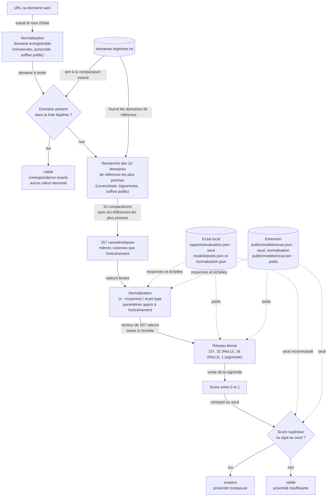
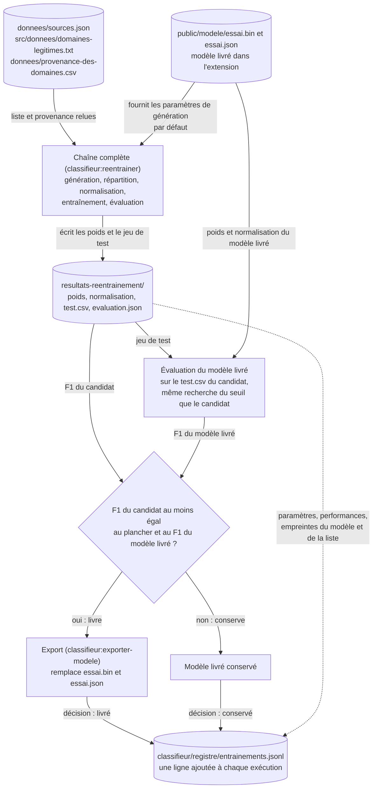

# Classifieur de typosquatting

Ce dossier permet de créer un jeu d'exemples, d'entraîner un modèle TensorFlow.js, de l'évaluer et d'essayer localement une URL avec les poids obtenus. Un modèle d'essai exporté est inclus dans l'extension pour comparer son résultat aux règles actuelles.

## Installer le projet

Installer **Node.js 26** et npm. Si le dépôt n'est pas encore présent :

```bash
git clone https://github.com/betagouv/lab-anssi-anti-typosquatting.git
cd lab-anssi-anti-typosquatting
```

Depuis la racine du dépôt, qui contient `package.json`, vérifier Node et installer exactement les dépendances du verrou npm :

```bash
node --version
npm ci
```

Toutes les commandes ci-dessous se lancent depuis cette racine. Elles fonctionnent aussi dans PowerShell.

## D'où viennent les données ?

L'entrée du classifieur est [`src/donnees/domaines-legitimes.txt`](../src/donnees/domaines-legitimes.txt), la liste légitime aussi utilisée par l'extension. Elle est générée par `npm run genere:domaines` à partir des sources déclarées dans [`donnees/sources.json`](../donnees/sources.json) (nom, URL, licence, rôle, mode de récupération) :

| Source | Contenu | Récupération |
| --- | --- | --- |
| `adullact` | `urls.txt` du dépôt [`dinum/noms-de-domaine-organismes-secteur-public`](https://gitlab.adullact.net/dinum/noms-de-domaine-organismes-secteur-public), uniquement des domaines répondant en HTTP 200 | téléchargement manuel (la forge bloque les scripts), versionné dans `donnees/snapshots/adullact-urls.txt` |
| `dpnt` | colonne `site_internet` du jeu [présence numérique des territoires](https://www.data.gouv.fr/datasets/donnees-de-la-presence-numerique-des-territoires) de l'ANCT, Licence Ouverte 2.0 | téléchargé à chaque génération, mis en cache dans `donnees-sources/` |
| `mediametrie` | domaine principal de chacune des 50 marques les plus visitées en France en juillet 2026 ([communiqué Médiamétrie//NetRatings](https://www.mediametrie.fr/system/files/2026-08/C1-O-COM%202026%2008%2025%20CP%20Audience%20Internet%20Global%20Juillet%202026.pdf)), copyright Médiamétrie : seuls les noms des marques sont repris | saisi à la main, versionné dans `donnees/sources/mediametrie-2026-07.csv` (`rang;marque;domaine`) |

Les règles de sélection s'appliquent à toutes les sources : sur les 50 marques, six plateformes de `src/donnees/domaines-exclus.txt` (Google, Facebook, YouTube, Instagram, LinkedIn, X) et `e.leclerc` (nom de moins de 4 caractères) ne sont pas retenus.

[`donnees/provenance-des-domaines.csv`](../donnees/provenance-des-domaines.csv) indique pour chaque domaine de la liste la ou les sources qui l'ont fourni (`domaine;sources`, sources séparées par `|`). Pour ajouter une source : écrire `scripts/sources/<id>.ts`, la déclarer dans `donnees/sources.json` et dans `scripts/genere-les-domaines-legitimes.ts`, puis regénérer la liste et réentraîner le modèle.

| Étape | Fichier lu | Fichier produit |
| --- | --- | --- |
| Création du jeu | `src/donnees/domaines-legitimes.txt` | `classifieur/resultats/donnees/jeu-entrainement.csv` |
| Répartition | `jeu-entrainement.csv` | `donnees/repartitions/entrainement.csv`, `validation.csv`, `test.csv` |
| Normalisation | `entrainement.csv` | `modele/normalisation.json` |
| Entraînement | `entrainement.csv`, `validation.csv`, `normalisation.json` | `modele/poids.json`, `rapports/entrainement.json` |
| Évaluation | `test.csv`, `poids.json`, `normalisation.json` | `rapports/evaluation.json` et son seuil recommandé |

Les lignes positives sont des variantes synthétiques de domaines légitimes ; les négatives sont des noms intermédiaires ou distants. Le modèle reçoit les caractéristiques numériques calculées à partir des dix domaines de référence les plus proches. Les variantes d'un même domaine source restent dans la même répartition. La normalisation est apprise sur l'entraînement seulement.

Train, la prédiction locale et l'extension emploient la même recherche de candidats, les mêmes 157 caractéristiques et la même normalisation. La génération n'impose plus de référence parmi les candidats. Les URL sont ramenées au domaine enregistrable, comme dans l'extension.

`rapports/provenance.json` contient l'empreinte SHA-256 du contenu source avec des fins de ligne LF, la graine et les paramètres de génération. Les résultats sont régénérables et ignorés par Git. Les poids peuvent varier légèrement d'une plateforme à l'autre.

## Flux de l'entraînement

Des sources publiques jusqu'au modèle embarqué. Les cylindres sont des fichiers, les rectangles des transformations (commande npm entre parenthèses). Sont versionnés : le manifeste des sources, le snapshot Adullact, le fichier des marques Médiamétrie, la liste légitime et sa provenance, la liste des plateformes exclues, le registre et le modèle exporté. `donnees-sources/` et `classifieur/resultats/` sont régénérables et ignorés par Git.

```mermaid
flowchart TD
    adullact[("donnees/snapshots/adullact-urls.txt<br/>urls.txt de l'ADULLACT, domaines en HTTP 200<br/>(téléchargé à la main, versionné)")]
    dpnt[("dpnt-quotidien.csv.gz<br/>présence numérique des territoires (ANCT)<br/>(téléchargé dans donnees-sources/)")]
    mediametrie[("donnees/sources/mediametrie-2026-07.csv<br/>domaine des 50 marques les plus visitées<br/>(saisi à la main, versionné)")]
    manifeste[("donnees/sources.json<br/>URL, licence, rôle de chaque source")]
    exclus[("src/donnees/domaines-exclus.txt<br/>plateformes à écarter")]
    filtre["Filtrage par source<br/>(genere:domaines)<br/>nom normalisable, hors suffixe privé,<br/>hors plateformes, étiquette de 4 caractères minimum"]
    liste[("src/donnees/domaines-legitimes.txt<br/>liste légitime versionnée")]
    provenanceDesDomaines[("donnees/provenance-des-domaines.csv<br/>source ou sources de chaque domaine")]

    adullact -- "lit les URL, extrait le nom d'hôte" --> filtre
    dpnt -- "lit la colonne site_internet" --> filtre
    mediametrie -- "lit la colonne domaine" --> filtre
    exclus -- "écarte les plateformes" --> filtre
    manifeste -. "déclare les sources<br/>(vérifié par un test)" .-> filtre
    filtre -- "écrit les domaines retenus, triés" --> liste
    filtre -- "écrit, pour chaque domaine,<br/>les sources qui l'ont fourni" --> provenanceDesDomaines

    generation["Génération des exemples<br/>(classifieur:generer)<br/>mutations synthétiques à partir de chaque domaine"]
    recherche["Recherche des 10 domaines<br/>de référence les plus proches<br/>puis calcul des 157 caractéristiques"]
    jeu[("jeu-entrainement.csv<br/>1 ligne par exemple, classe 0 ou 1")]
    provenance[("provenance.json<br/>empreinte SHA-256 de la liste, graine, paramètres")]

    liste -- "lit chaque domaine légitime<br/>comme domaine source" --> generation
    generation -- "positifs : imitations<br/>(leet, caractère retiré ou ajouté,<br/>transposition, tiret)" --> recherche
    generation -- "négatifs : noms intermédiaires<br/>et noms distants" --> recherche
    recherche -- "écrit une ligne par exemple<br/>avec sa classe" --> jeu
    generation -. "enregistre l'empreinte de la liste,<br/>la graine et les paramètres" .-> provenance

    repartition["Répartition<br/>(classifieur:repartir)<br/>hachage du domaine source :<br/>70 % entraînement, 15 % validation, 15 % test"]
    csvEntrainement[("entrainement.csv")]
    csvValidation[("validation.csv")]
    csvTest[("test.csv")]

    jeu -- "lit toutes les lignes" --> repartition
    repartition -- "70 % des domaines sources" --> csvEntrainement
    repartition -- "15 % des domaines sources" --> csvValidation
    repartition -- "15 % des domaines sources" --> csvTest

    normalisation["Normalisation<br/>(classifieur:normaliser)<br/>moyenne et écart-type par colonne,<br/>appris sur l'entraînement seul"]
    paramNorm[("normalisation.json")]

    csvEntrainement -- "calcule moyennes et écarts-types" --> normalisation
    normalisation -- "enregistre les paramètres" --> paramNorm

    entrainement["Entraînement<br/>(classifieur:entrainer)<br/>réseau 157, 32, 16, 1 ; perte binaryCrossentropy ;<br/>arrêt après 4 époques sans progrès en validation"]
    poids[("poids.json<br/>meilleure époque en validation")]
    rapportEntrainement[("entrainement.json<br/>historique des pertes")]

    csvEntrainement -- "ajuste les poids, lot par lot" --> entrainement
    csvValidation -- "mesure la perte à chaque époque" --> entrainement
    paramNorm -- "met les caractéristiques à l'échelle" --> entrainement
    entrainement -- "enregistre les poids<br/>à chaque amélioration" --> poids
    entrainement -. "écrit l'historique des pertes" .-> rapportEntrainement

    evaluation["Évaluation<br/>(classifieur:evaluer)<br/>seuil de 0,05 à 0,95 qui maximise le F1"]
    rapportEvaluation[("evaluation.json<br/>seuil recommandé, mesures par seuil")]

    csvTest -- "fournit des exemples jamais vus" --> evaluation
    poids -- "charge le modèle<br/>et calcule un score par exemple" --> evaluation
    paramNorm -- "met les caractéristiques à l'échelle" --> evaluation
    evaluation -- "écrit le seuil retenu<br/>et les mesures par seuil" --> rapportEvaluation

    export["Export<br/>(classifieur:exporter-modele)<br/>vérifie l'architecture et les empreintes,<br/>poids en float32"]
    embarque[("public/modele/essai.bin et essai.json<br/>poids, normalisation compacte, seuil, empreintes<br/>versionnés et embarqués dans l'extension")]

    poids -- "fournit les poids" --> export
    paramNorm -- "fournit la normalisation" --> export
    rapportEvaluation -- "fournit le seuil et l'empreinte du modèle" --> export
    provenance -- "fournit l'empreinte de la liste<br/>et les paramètres de génération" --> export
    export -- "écrit les poids en binaire<br/>et les métadonnées en JSON" --> embarque
```



Les étapes suivantes relisent `provenance.json` et refusent de continuer si la liste légitime a changé depuis la génération, ou si les poids ont changé depuis l'évaluation.

## Flux de l'inférence

Le même calcul sert à l'essai local (`classifieur:predire`, avec TensorFlow.js) et à l'extension (calcul TypeScript des trois couches, sur les fichiers exportés). Les caractéristiques et la normalisation viennent du même code, `src/noyau/modele/`.



Dans l'extension, la fenêtre de comparaison affiche ce verdict à côté de celui des règles (`src/noyau/detection.ts`), pour le domaine de l'onglet courant. Seules les règles déclenchent les alertes ; les sites hors périmètre (suffixe privé ou plateforme exclue) ne passent pas par le modèle.

## Entraîner le modèle

Pour vérifier rapidement toute la chaîne sur 1 000 domaines sources, avec des résultats isolés dans `classifieur/resultats-essai/` :

```bash
npm run classifieur:essai
```

Pour utiliser **toute** la liste légitime et écrire dans `classifieur/resultats/` :

```bash
npm run classifieur:chaine
```

La chaîne complète peut être longue. Pour réduire encore l'essai et suivre deux époques :

```bash
npm run classifieur:essai -- --limite=100 --epoques=2 --taille-du-lot=64
```

Chaque étape peut également être lancée séparément, dans cet ordre :

```bash
npm run classifieur:generer
npm run classifieur:repartir
npm run classifieur:normaliser
npm run classifieur:entrainer
npm run classifieur:evaluer
```

Les paramètres par défaut sont une graine `20260917`, quatre imitations, quatre exemples intermédiaires et deux exemples distants visés par domaine, 25 époques au maximum et des lots de 256. `--limite=0` utilise toute la liste. Les options `--graine`, `--limite`, `--epoques`, `--taille-du-lot` et `--repertoire` se passent après `--` ; `--repertoire` doit être identique pour chaque étape exécutée séparément. La génération accepte aussi `--imitations-par-domaine`, `--intermediaires-par-domaine`, `--distants-par-domaine` et les trois options de seuil `--score-minimum-imitation`, `--score-minimum-intermediaire`, `--score-maximum-intermediaire`.

## Essayer une URL avec les poids entraînés

Après `classifieur:chaine`, interroger le modèle complet :

```bash
npm run classifieur:predire -- https://imp0ts.gouv.fr
npm run classifieur:predire -- https://nouveau-domaine.fr
npm run classifieur:predire -- https://impots.gouv.fr
```

Après `classifieur:essai`, sélectionner les poids de cet essai :

```bash
npm run classifieur:predire -- https://imp0ts.gouv.fr --repertoire=classifieur/resultats-essai
npm run classifieur:predire -- https://nouveau-domaine.fr --repertoire=classifieur/resultats-essai
```

La commande exige `modele/poids.json`, `modele/normalisation.json`, `rapports/evaluation.json` et `rapports/provenance.json` dans le répertoire choisi. Elle vérifie que la liste source et les poids correspondent à ceux de l'évaluation, puis affiche en JSON la décision (`suspect` ou `valide`), la probabilité, le seuil et les références proches. Un domaine présent exactement dans la liste est classé `valide` par la règle de référence, sans calcul neuronal. Tester `imp0ts.gouv.fr` exerce donc le modèle, tandis que `impots.gouv.fr` vérifie la règle de correspondance exacte.

Ici, `valide` signifie seulement qu'aucune proximité trompeuse suffisante n'a été détectée avec la liste de référence. Les exemples d'apprentissage étant synthétiques, le score ne représente pas une probabilité opérationnelle de fraude. Le seuil et le F1 sont choisis sur le jeu de test, comme dans le prototype : le F1 affiché reste une mesure exploratoire.

## Exporter le modèle d'essai pour l'extension

La version embarquée est entraînée avec les paramètres de `classifieur:essai` : 1 000 domaines sources, graine `20260917`, jusqu'à 12 époques. Après un entraînement et son évaluation :

```bash
npm run classifieur:essai
npm run classifieur:exporter-modele
npm run classifieur:verifier-export
```

L'export écrit `public/modele/essai.bin` (poids float32) et `public/modele/essai.json` (ordre des colonnes, normalisation, seuil, empreintes et paramètres). Ces deux fichiers sont versionnés et embarqués dans les paquets Chrome et Firefox. La commande d'export refuse une liste source, des poids, une architecture ou une normalisation incompatibles ; `classifieur:verifier-export` vérifie de nouveau l'export sans entraîner le modèle. Si la liste légitime change, réentraîner et exporter avant de livrer l'extension : `classifieur:reentrainer` enchaîne les deux et ne livre le modèle que s'il tient la comparaison.

L'inférence de l'extension utilise un calcul TypeScript limité aux trois couches du modèle. Le test de parité compare ses scores à TensorFlow.js. La fenêtre ouverte depuis l'icône affiche le résultat expérimental et celui des règles pour le domaine courant ; seul ce dernier pilote les alertes.

## Réentraîner et livrer un nouveau modèle

Quand les sources ou la liste changent, une seule commande relance toute la chaîne, compare le résultat au modèle livré et ne le remplace que s'il est au moins aussi bon :

```bash
npm run classifieur:reentrainer
```

Par défaut, le candidat est entraîné avec les paramètres du modèle livré (lus dans `public/modele/essai.json` : graine, nombre de domaines sources, quantités et seuils de génération), 12 époques et des lots de 512, dans `classifieur/resultats-reentrainement/`. Toutes les options de `classifieur:essai` s'appliquent. Deux options règlent la décision : `--plancher-f1` (0,95 par défaut) et `--tolerance` (0 par défaut, écart de F1 toléré par rapport au modèle livré).



Chaque exécution ajoute une ligne JSON au registre (`classifieur/registre/entrainements.jsonl`, versionné, jamais réécrit) avec : la date ; l'empreinte de la liste et celle de la provenance, le nombre de domaines et leur répartition par source ; les paramètres de génération ; les lignes d'entraînement, les époques et la meilleure perte de validation ; l'empreinte du modèle ; le seuil, la précision, le rappel et le F1 sur le jeu de test ; la décision et sa raison. Une exécution dont la décision est « conservé » est consignée aussi. Le registre se commite avec le modèle ou la liste qu'il documente.

Limites à connaître :

- Les exemples d'apprentissage et de test sont synthétiques : le F1 ne mesure pas le taux de faux avertissements sur de vrais domaines légitimes inconnus.
- Le seuil de chaque modèle est choisi sur le jeu de test, pour le candidat comme pour le modèle livré : la comparaison est homogène, mais optimiste.
- Le modèle livré est évalué sur le jeu de test du candidat. Il a pu être entraîné sur certains de ces domaines, ce qui le favorise légèrement.
- Un candidat identique au modèle livré (mêmes données, mêmes paramètres) est « livré » sans changer un octet de `essai.bin`.

## Vérifier le code

```bash
npm run typecheck
npm run lint
npm test
npm run classifieur:verifier-chaine
npm run classifieur:verifier-export
```

`classifieur:verifier-chaine` est le contrôle de bout en bout exécuté en CI. Il génère des exemples à partir de `src/donnees/domaines-legitimes.txt`, retient exactement dix lignes (six pour l'entraînement, deux pour la validation et deux pour le test), avec les deux classes dans chaque répartition et sans mélanger les variantes d'un domaine source entre répartitions. Il normalise, entraîne pendant une époque, évalue et prédit une URL absente de la liste. La commande vérifie les artefacts et la validité numérique de la prédiction ; elle n'impose aucun score ni verdict. Tous ses fichiers sont créés dans un répertoire temporaire supprimé à la fin.

Le code est organisé par étapes dans `creation-du-dataset/`, `entrainement/`, `evaluation/`, `inference/`, `exportation/` et `verification/`. Le calcul partagé avec l'extension se trouve dans `src/noyau/modele/`. `commun/` regroupe les accès aux fichiers et `ligne-de-commande/` expose les commandes usuelles.
